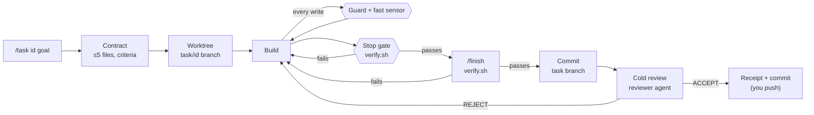

# Coding Harness Boilerplate

**A drop-in harness that makes Claude Code work in bounded, verified, reviewable tasks.**

[](LICENSE)
[](CHANGELOG.md)

Copy it into a new or existing repo, fill in a few placeholders, and Claude Code starts working
the way a careful engineer does. It writes down the scope first, works on a branch, runs the
tests before saying "done", gets a second opinion, and leaves a receipt.

---

## Why

Left alone, coding agents tend to:

- **drift out of scope**: "while I was there, I also refactored…"
- **claim success without evidence**: "all tests pass" when no tests ran
- **loop**: they retry the same failing fix until the context runs out
- **touch what they shouldn't**: secrets, generated files, the main branch

Writing "please don't" in a prompt helps a little. This boilerplate rests on two ideas instead:

1. **The harness is the machine.** Every rule that must always hold is a hook, a script or a
   permission, not a sentence the model may forget 40 messages later.
2. **A model team.** Cheap models search and run tests, a mid-tier model builds and reviews, and
   the most expensive model only plans and judges. You get better results and pay less.

## What you get

| Piece | Where | What it does |
|---|---|---|
| **Guard** | `.claude/hooks/guard-write.sh` | Blocks writes to secrets, to `main`, to harness files and danger zones, and, while a task is active, to anything outside its contract |
| **Fast sensor** | `.claude/hooks/post-edit-check.sh` | Checks each file right after Claude edits it: syntax always, plus format and lint where ruff, prettier or eslint is installed |
| **Stop gate** | `.claude/hooks/stop-gate.sh` | Claude can't end its turn while `verify.sh` fails or the task has no receipt, with a loop breaker after 3 blocked stops in a row |
| **Definition of done** | `scripts/verify.sh` | One script for typecheck, lint and tests. Exit 0 is the only proof that counts |
| **Agent team** | `.claude/agents/` | `Explore` (haiku), `test-runner` (haiku), `reviewer` (sonnet), `architect` (opus) |
| **Slash commands** | `.claude/commands/` | `/task <id> <goal>` starts a bounded task; `/finish` verifies, commits on the task branch, gets a cold review and writes the receipt |
| **Skills** | `.claude/skills/` | `debug`, `refactor`, `code-review`, `release`, `herdr-subagents` |
| **Policy** | `.claude/settings.json` | Allow/ask/deny lists: no `curl`, no `git push` without asking, no reading `.env` |
| **Task state** | `.agent/` | Contracts, receipts and a lessons log on disk, so they survive a crashed session |
| **Docs on demand** | `docs/` | Architecture, ADRs and runbooks that Claude opens only when it needs them |
| **Self-test** | `tests/harness/run.sh` | Proves the hooks still block what they should |

The full file map and design notes are in [`docs/harness.md`](docs/harness.md).

## How a task flows



`/finish` commits before the review so the reviewer can see the work in `git diff main...HEAD`.
Review fixes are new commits, and the receipt records the real SHA.

Nothing is pushed or merged for you. The agent prepares the work and you publish it.

## Requirements

- [Claude Code](https://docs.claude.com/en/docs/claude-code/overview)
- `git` (worktrees need a first commit), `bash` (3.2+ works, so the macOS default is fine)
- `jq` **or** `python3`, used by the hooks to read Claude Code's JSON input
- Optional: [Herdr](https://herdr.dev) to run subagents in hidden terminal tabs, and `shellcheck`
  for a stricter self-test

## Quickstart

### 1. Get the files

Pick one:

```bash
# A. New repo on GitHub: click "Use this template" on the repo page, then clone your copy.

# B. New local project without git history
npx degit Hephest/coding-harness-boilerplate my-app && cd my-app

# C. Existing project: copy the harness in (check for clashes with your CLAUDE.md / .gitignore)
git clone --depth 1 https://github.com/Hephest/coding-harness-boilerplate /tmp/harness
cp -R /tmp/harness/{.claude,.agent,scripts,tests,docs,CLAUDE.md} .
cat /tmp/harness/.gitignore >> .gitignore
```

### 2. Make it yours

1. **`CLAUDE.md`**: fill in the `<placeholders>` (project, stack, run command) and adjust the
   repo map. Keep it under 150 lines.
2. **`scripts/verify.sh`**: set `TYPECHECK_CMD`, `LINT_CMD` and `TEST_CMD` in the CONFIG block.
   It auto-detects common setups (npm `lint`/`test` scripts, `tsc`, ruff, pyright, pytest), but
   explicit commands are clearer. If it finds no sensors at all, it exits `78` ("no sensors
   configured") on purpose, because with no sensors nothing is verified.
3. **`.claude/protected-paths`**: list your danger zones (auth, billing, migrations, infra…).
4. **`README.md`, `CHANGELOG.md`, `LICENSE` and `SECURITY.md`**: these describe the boilerplate.
   Replace them with your project's own. `.claude/HARNESS_VERSION` keeps a record of which
   harness release you started from. The file is created at release, so a copy of unreleased
   `main` doesn't have it.

> **You edit the harness files, Claude doesn't.** The guard blocks Claude from changing hooks,
> `settings.json`, `protected-paths`, `verify.sh`, `herdr-sub.sh`, agents, skills, slash
> commands and the self-test. It can propose a change, and you apply it.
> An agent that can rewrite its own sensors has no sensors.

### 3. First commit, first task

```bash
git init -b main          # skip if the repo already exists
git add -A && git commit -m "chore: add coding harness"
claude
```

Then, inside Claude Code:

```
/task add-health-endpoint Add GET /health that returns {"ok": true}
```

Claude writes the contract and asks the `architect` to check it, then shows it to you. After
your "yes" it creates `.worktrees/add-health-endpoint` and tells you to continue from there.

## A day with the harness

```text
you     /task fix-login-redirect Users land on /home instead of ?next= after login
claude  Contract written: 2 target files, 3 acceptance criteria. OK to start?
you     yes
claude  Worktree ready. Continue from .worktrees/fix-login-redirect
        … edits src/routes/login.ts …
guard   BLOCKED: 'src/routes/redirect.ts' is outside the contract for 'fix-login-redirect'.
claude  That file needs to change too. Can I add it to the contract?
        … tries to stop …
gate    NOT DONE (blocked stop 1/3): scripts/verify.sh failed (exit 1). Last lines: …
        … fixes the test …
you     /finish
claude  verify: PASS · committed on task/fix-login-redirect
        reviewer: ACCEPT · receipt: .agent/receipts/fix-login-redirect.md
        Not pushed.
```

Each message from the guard or the gate tells Claude exactly what to do next. When something
keeps failing, the gate blocks at most three stops in a row, even if the failure text changes
each time. The third block tells Claude to ask the `architect` and report to you, and the next
stop goes through, so a stuck task doesn't burn tokens.

## Concepts

| Concept | In one paragraph |
|---|---|
| **Contract** | `.agent/contracts/<id>.md`: the goal, **at most 5 target files** (globs allowed), acceptance criteria that map to tests, what's out of scope, and an attempt ceiling. If a task needs more than 5 files, split it. The guard only allows writes to the listed files. |
| **Worktree** | Each task gets its own checkout on a `task/<id>` branch under `.worktrees/`. `main` stays clean, and you can throw a failed attempt away with one command. |
| **Guard** | A PreToolUse hook that runs before every Edit/Write. Exit 2 blocks the write and tells Claude why. |
| **Sensors** | Tools that measure "done": the fast check per edit, and the full `verify.sh` at the Stop gate. |
| **Stop gate & loop breaker** | Claude can't finish while `verify.sh` fails or the active task has no receipt. The gate blocks at most 3 stops in a row, whatever the failure text says, and then lets Claude stop so it can escalate. "No sensors configured" (`verify.sh` exit 78) blocks once per session, then allows the stop, and never counts toward the loop breaker, so a fresh project doesn't trap you. |
| **Receipt** | `.agent/receipts/<id>.md`: a 15-second audit covering status, verify result, reviewer verdict, files changed and attempts used. |
| **Lessons → infrastructure** | Every failure gets one line in `.agent/lessons.md` **and** a permanent fix: a rule, test fixture, script or hook. A fix that lives only in a chat is lost. |
| **Danger zones** | Paths in `.claude/protected-paths`. They can only be edited when the active contract names them specifically. Give each one a local `CLAUDE.md` ([template](docs/templates/MODULE_CLAUDE.md)). |
| **Model routing** | Start the session on the model you build with (`claude --model sonnet`), or `/model opusplan` to plan on Opus and build on Sonnet. Subagents bring their own model. Don't switch mid-task, because the cache resets. |

## Customizing

- **Add a rule for a path:** copy `.claude/rules/auth.md`. The `paths:` frontmatter makes Claude
  load it only when it works on matching files.
- **Add a sensor:** add a command to the CONFIG block in `scripts/verify.sh`, or add a
  path-scoped sensor to `SCOPED_SENSORS` so it runs only when those files change.
- **Add a danger zone:** add a glob to `.claude/protected-paths` and a local `CLAUDE.md` in
  that folder.
- **Add an agent or skill:** drop a Markdown file into `.claude/agents/` or
  `.claude/skills/<name>/SKILL.md`.
- **Safe to delete:** `.claude/rules/auth.md` and the example rows in `.agent/lessons.md` (both
  are examples), and the Herdr skill and `scripts/herdr-sub.sh` if you don't use Herdr.

## Optional: Herdr

[Herdr](https://herdr.dev) is a terminal multiplexer for coding agents. If you start `claude`
inside a Herdr pane (`HERDR_ENV=1`), the `herdr-subagents` skill runs every subagent through
`scripts/herdr-sub.sh` in its own hidden tab. Your pane stays clean: no test logs and no file
dumps, only the subagent's short report.

```bash
herdr integration install claude   # once, for accurate agent states
```

Without Herdr, the same agents run through Claude Code's built-in Agent tool. Nothing else
changes.

## Security model and limitations

These are **guardrails, not a sandbox**. They stop an agent that is following its instructions
and keep honest mistakes small. They do not stop a determined adversary. Known gaps in v0.1:

- The guard only watches the Edit/Write tools. A shell command (`sed -i`, `echo >`) can still
  write files.
- The agent can write its own contract (`.agent/` is writable so `/task` works). The "wait for
  my yes" step is a convention, not an enforcement.
- `settings.json` denies *reading* `.env` with the Read tool, but a shell `cat .env` isn't
  covered by that rule.
- Not every file that shapes the agent's behaviour is guarded. `CLAUDE.md`, `.claude/rules/`
  and `.agent/lessons.md` stay editable, and notebook edits aren't checked.
- The force-add deny only matches a command's prefix. `git add -f` is denied, but
  `git add -A -f` may pass.
- The guard needs `git`. Without it, every path looks like it's outside a repo, so only the
  `.git` check runs and the write is allowed.

The guard itself fails closed: if it can't parse its input (malformed, or no jq and no working
python3), it blocks the write. It checks the real path behind any symlink, blocks a detached
HEAD like `main`, and blocks `.env`, `.env.*`, `.npmrc`, `.netrc`, `id_rsa*`, `*.pem`, `*.key`,
`*.p12` and `*.pfx` at any depth, as well as a top-level `secrets/` and `.git` internals. Slash
commands and the self-test are harness files, like the hooks.

Run Claude Code with its own permission prompts on, and review diffs before you merge. See
[SECURITY.md](SECURITY.md) for the threat model and how to report a problem.

## Versioning and upgrading

The harness uses [Semantic Versioning](https://semver.org). The current version is in
`.claude/HARNESS_VERSION`, which is created at release, and every change is listed in
[CHANGELOG.md](CHANGELOG.md).

- **Major:** something you must act on, such as a changed contract format, a renamed script or
  command, or new hook wiring.
- **Minor:** a new opt-in agent, skill, rule or sensor.
- **Patch:** fixes and docs.

To upgrade a project that started from an older version:

```bash
cat .claude/HARNESS_VERSION                     # e.g. 0.1.0
# In a clone of this repo, see what changed in the harness files since then:
git diff v0.1.0 v0.2.0 -- .claude scripts tests/harness .agent/contracts/TEMPLATE.md .agent/receipts/TEMPLATE.md
```

Read the "Upgrading" notes in the CHANGELOG for each version in between, apply the diff to your
project, and update `.claude/HARNESS_VERSION`.

## Credits

The core ideas (*the harness is the machine*, *the model team* and the seven invariants) come
from these posts:

- https://x.com/swadeshkumar_/status/2117564218803392849
- https://x.com/damkina7/status/2115794667706957858
- https://x.com/0xMfox/status/2115825484529311955

The Herdr integration, maintainer mode, the self-test and the packaging are this project's own
additions. Not affiliated with Anthropic or Herdr.

## Contributing

Issues and pull requests are welcome. [CONTRIBUTING.md](CONTRIBUTING.md) explains how to work
on the harness with the harness, including maintainer mode.

## License

[MIT](LICENSE)
